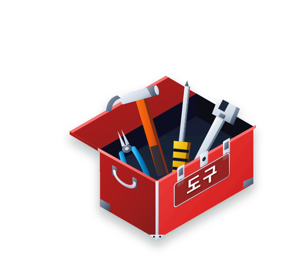

= dogu
:toc: left
:stylesheet: style.css
:icons: font
:source-highlighter: highlight.js

`dogu` is a multiplatform command-line tool written in Go that seamlessly provisions and configures developer toolchains.
_Dogu_ is Korean for _tools_.

== Overview & Features

* **On-Demand Tool Provisioning:** Automatically downloads, unpacks, and registers candidate tool releases.
* **Environment Variable Automation:** Sets version-specific environment variables (e.g. `JAVA_17_HOME`, `JAVA_21_HOME`, `JAVA_HOME`, `NODE_24_HOME`, `NODE_HOME`) and prepends `PATH`.
* **Flexible Mirror Support:** Configure custom download mirror URLs via `config.json` files or environment variables.
* **Multiplatform Support:** Works across Linux, macOS, and Windows.

== Usage & CLI Flags

=== Command Syntax

Run any command prefixed with `dogu` and the desired tool or CLI flags:

[source,bash]
----
dogu [-v|--verbose] [--force] [tools...] -- <command> [args...]
----

=== Flags

|===
| Flag | Description

| `-v, --verbose` | Enable verbose logging.
| `-f, --force` | Force re-downloading candidate versions even if already installed.
| `--prerelease` | Include release candidates / pre-releases when resolving partial versions (default is `false`).
| `-h, --help` | Show usage information.
|===

=== Examples

Run Maven tests with Java, Maven, and Node.js provisioned:

[source,bash]
----
dogu --java 21 --maven 3.9 --node 24 -- mvn clean test
----

Run Pytest with Python and UV provisioned:

[source,bash]
----
dogu --python 3.11 --uv 0.5 -- pytest
----

Install Node dependencies with pnpm:

[source,bash]
----
dogu --node 20 --pnpm 8.15 -- pnpm install
----

== Candidate Storage

Candidate binaries are cached and unpacked at `$DOGU_HOME/candidates`.
If `DOGU_HOME` is not set, `dogu` defaults to `$HOME/.dogu`.

include::configuration.adoc[leveloffset=+1]

include::tools.adoc[leveloffset=+1]
